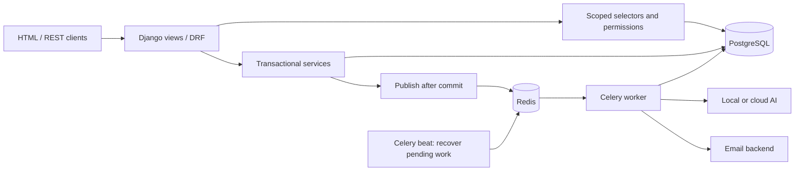
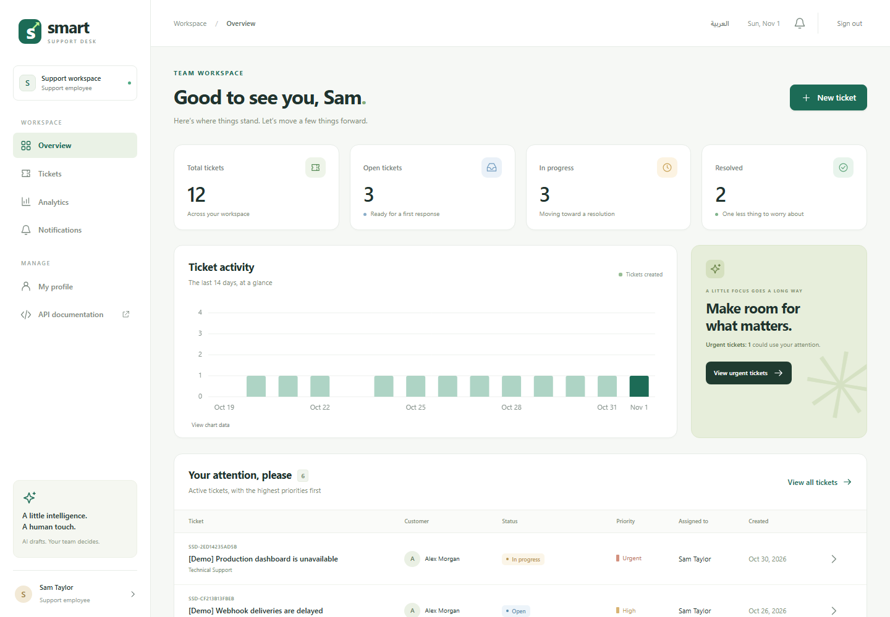
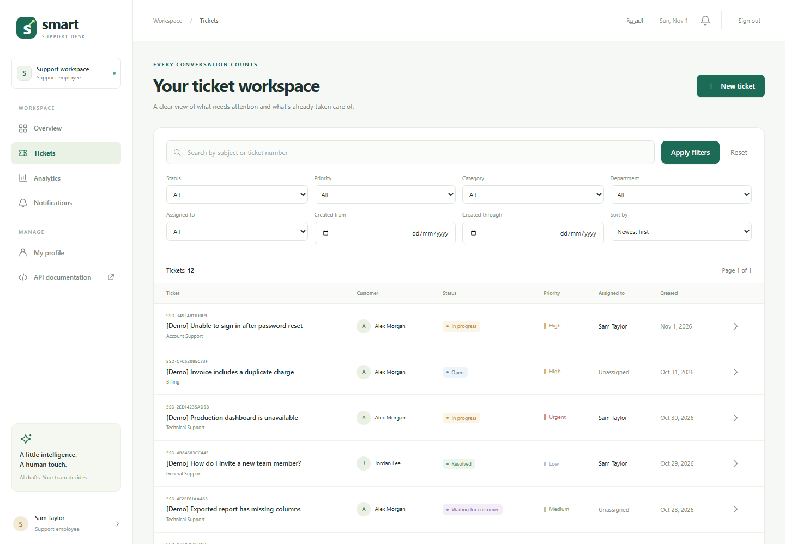
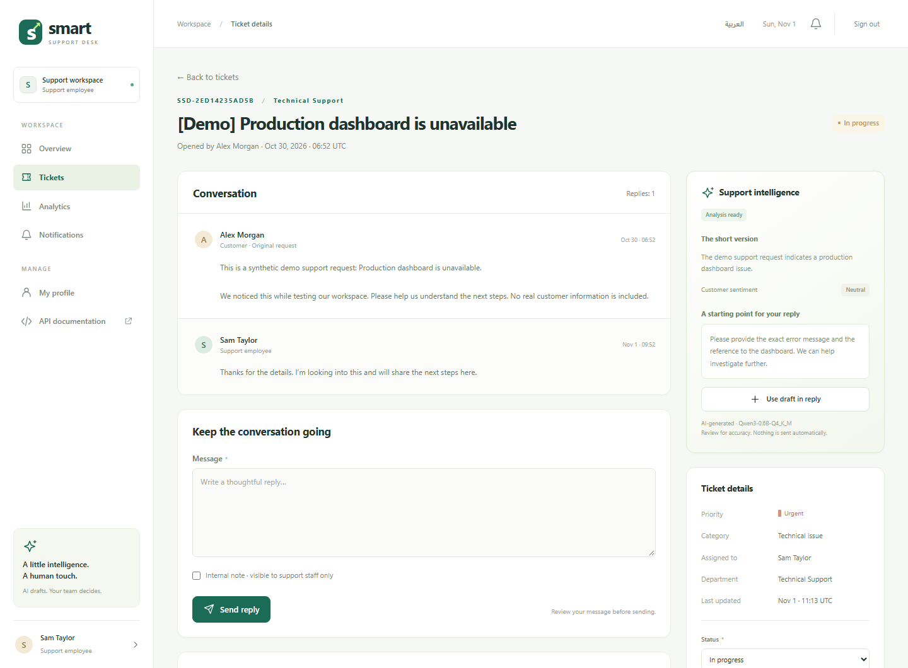
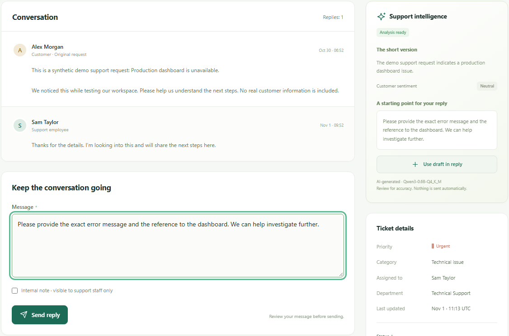
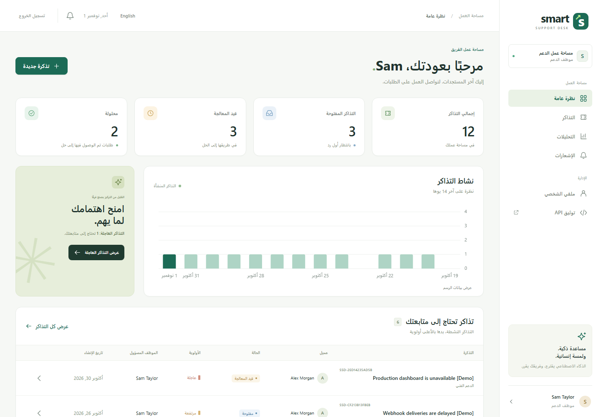
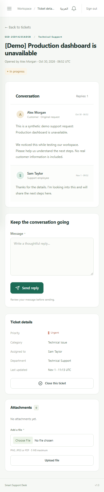

# Smart Support Desk

[](https://github.com/tayma-ops/smart-support-system/actions/workflows/ci.yml)

## Project Overview

Smart Support Desk turns scattered customer requests into scoped, traceable support workflows. Customers track tickets and conversations; support teams manage ownership, private notes and human-reviewed AI drafts in one bilingual workspace.

A Python / Django portfolio project with **PostgreSQL, a scoped REST API, Redis, Celery, Docker support and automated tests**. English and Arabic share the same workflows, with RTL navigation. Real local AI inference works without a paid API key.

## At a glance

- **Access control:** customers see their own tickets; employees work within assigned tickets and department queues; administrators manage the workspace.
- **Reliable workflows:** transactional services, PostgreSQL row locks, audit events and background-job recovery after broker outages.
- **Human-reviewed AI:** summaries, suggested triage and editable drafts; generated text is never sent to customers automatically.
- **Verification:** 83 PostgreSQL tests, including concurrency and security cases; native customer/staff HTTP, local-model and SMTP checks; and a [successful GitHub Actions run](https://github.com/tayma-ops/smart-support-system/actions/runs/41319932659) covering Linux tests, Docker Compose and worker/HTTP integration. See the [verification record](docs/VERIFICATION.md).

Docker Compose and Linux CI have been verified on GitHub Actions. Real desktop, Arabic RTL and mobile captures are included below, with a focused browser review. No public application deployment is claimed.

[Engineering guide](docs/ENGINEERING.md) · [API reference](docs/ENGINEERING.md#rest-api) · [Screenshot notes](docs/screenshots/README.md) · [Arabic readiness report](docs/GITHUB-READINESS.ar.md)

## Why This Project Is More Than a CRUD Application

- **Authentication and permissions:** session and JWT authentication, customer/employee/administrator roles, and object-level ticket access enforced across HTML views and REST APIs.
- **PostgreSQL workflows:** relational constraints, transactional services and row locks protect assignment and concurrent updates.
- **Background and scheduled tasks:** Redis and Celery process AI analysis and notifications; Celery beat schedules pending-job recovery and expired-token cleanup.
- **AI-assisted workflow with human review:** staff review and edit generated suggestions before explicitly sending a response. AI drafts are never sent automatically.
- **Engineering and security:** automated tests cover permissions, concurrency and failure handling. CSRF protection, private uploads, environment-based secrets and production-oriented HTTPS/Gunicorn configuration support a deployable design. Docker startup is verified in CI; public deployment still requires operational review.

## Features

| Area | Implemented behavior |
| --- | --- |
| Accounts | Registration, sessions, rotating JWTs, password reset/change, profile and role management |
| Tickets | Departments, assignment, lifecycle transitions, search, filters, pagination and priority ordering |
| Collaboration | Public replies, staff-only internal notes, event history and in-app notifications |
| Attachments | Private PNG/JPEG/PDF uploads, validation and authorized downloads |
| Reporting | Role-scoped metrics, activity charts, accessible data tables and analytics API |
| AI | Local llama.cpp or cloud adapter, validated structured output and editable drafts |
| Interface | Responsive templates, English/Arabic, RTL and a CSRF-protected language switch |
| Developer tools | OpenAPI/Swagger, safe demo seeding, integration scripts and GitHub Actions |

## Tech stack

| Layer | Technology |
| --- | --- |
| Backend / REST APIs | Python 3.14, Django 6.1, Django REST Framework 3.18, Simple JWT |
| Data / jobs | PostgreSQL 18, Redis 8, Celery worker and beat |
| Frontend | Django templates, HTML, custom CSS, vanilla JavaScript and canvas |
| AI | HTTPX, llama.cpp local inference, OpenAI Responses adapter |
| Delivery / checks | Docker Compose, Gunicorn, WhiteNoise, Django tests, Ruff, Black, djLint |
| Version control / CI | Git repository and GitHub Actions configuration for push and pull requests |

Runtime dependencies are pinned in `requirements.txt`; development tools are separate in `requirements-dev.txt`.

## Architecture



PostgreSQL stores pending job state. Beat recovers pending work and expired leases every minute. Email delivery is at least once; a crash after SMTP acceptance can cause a duplicate. HTML and API operations share domain services and visibility rules.

## Authentication & Permissions

| Role | Access |
| --- | --- |
| Customer | Own tickets, public replies, private attachments and closing |
| Employee | Assigned work, own submitted tickets and unassigned tickets in member departments; claiming requires department eligibility |
| Administrator | Workspace-wide ticket access, user/role and department management |

Browser forms use Django sessions and CSRF protection. REST clients can use short-lived JWT access tokens with rotating, blacklisted refresh tokens and password-change revocation. Object-level selectors and transactional services enforce the same scope in both interfaces. Assignment transfers require administrator access or the dedicated assignment permission.

## REST APIs

Interactive Swagger is available at `/api/docs/`; the live schema is `/api/schema/`, with a checked-in [OpenAPI snapshot](schema.yaml).

| Endpoint or route group | Purpose |
| --- | --- |
| Endpoints under `/api/auth/` | Registration, token issuance/refresh/logout, profile and password change |
| `/api/tickets/` | Scoped creation/list/details, triage and administrator deletion |
| Workflow actions under `/api/tickets/{id}/` | Public replies/notes (`reply/`), status (`status/`), assignment (`assign/`) and uploads (`attachments/`) |
| `/api/departments/`, `/api/users/`, `/api/notifications/` | Department, administrator user management and scoped notifications |
| `/api/dashboard/` | Aggregates for the authenticated user's visible tickets |

See the [complete endpoint and permission reference](docs/ENGINEERING.md#rest-api) for methods, request bodies, filters and download authorization.

## Run locally

Use Python 3.14. Commands assume an activated virtual environment, from the repository root.

```text
git clone https://github.com/tayma-ops/smart-support-system.git
cd smart-support-system
```

```powershell
python -m venv .venv
.\.venv\Scripts\Activate.ps1
python -m pip install -r requirements.txt
```

On Linux/macOS, activate with `source .venv/bin/activate`. Without Windows activation, use `.\.venv\Scripts\python.exe` instead of `python`.

### Quick review without external services

```text
python scripts/bootstrap.py --sqlite --seed
python manage.py runserver
```

Open **http://127.0.0.1:8000/**. Bootstrap creates a private `.env`, migrates the database and prints generated demo credentials. Existing `.env` files and accounts are preserved; flags do not overwrite them. SQLite and synchronous tasks are explicit demo options; PostgreSQL is the default.

### PostgreSQL, Redis and asynchronous jobs

Install/start PostgreSQL and Redis, then run `python scripts/bootstrap.py --configure-only`. Set `DB_*`, `CELERY_BROKER_URL` and `CACHE_URL` in the generated private `.env`. Keep `USE_SQLITE=False` and `CELERY_TASK_ALWAYS_EAGER=False`. [Create the PostgreSQL role/database](docs/ENGINEERING.md#postgresql-and-running-locally) matching that configuration, then run:

```text
python manage.py migrate
python manage.py createsuperuser
python manage.py collectstatic --noinput
python manage.py runserver
```

In two additional terminals with the same environment:

```text
celery -A config worker --loglevel=INFO
celery -A config beat --loglevel=INFO
```

Run one beat scheduler. On native Windows, `--pool=solo` was verified for this development checkout; Celery does not officially support Windows. Linux workers are the deployment path. See the [service guide](docs/ENGINEERING.md#celery-and-redis) and [this checkout's native setup](docs/LOCAL-SETUP.ar.md).

### Docker Compose

Requires Docker and Compose v2. Configuration generation uses Python's standard library; no host Django installation is needed.

```text
python scripts/bootstrap.py --configure-only
docker compose up --build -d --wait
docker compose exec web python manage.py createsuperuser
docker compose exec web python manage.py seed_demo
```

The optional seed requires debug mode. Compose starts PostgreSQL, Redis, Django, worker and beat after a one-shot migration/static collection service. App containers run without root; named volumes persist data and private media. Only web port 8000 is exposed, on loopback; free that port first.

Compose uses its own database and overrides native connection addresses/eager mode. If reusing a native local-model `.env`, follow the [container AI notes](docs/ENGINEERING.md#docker): loopback inside a container refers to that container. The supplied stack targets local HTTP development; public hosting needs reviewed HTTPS configuration. Image build, Compose startup and containerized worker/HTTP smoke checks passed on GitHub Actions Linux. Docker was not installed or run on the original Windows workstation.

## Configuration

Start from [`.env.example`](.env.example). Keep private values in ignored `.env` files.

| Variables | Purpose |
| --- | --- |
| `SECRET_KEY`, `DJANGO_DEBUG`, `ALLOWED_HOSTS`, `CSRF_TRUSTED_ORIGINS` | Signing, debug mode, hosts and trusted origins |
| `DB_NAME`, `DB_USER`, `DB_PASSWORD`, `DB_HOST`, `DB_PORT` | PostgreSQL connection |
| `USE_SQLITE` | Optional local SQLite mode |
| `CELERY_BROKER_URL`, `CACHE_URL`, `CELERY_TASK_ALWAYS_EAGER`, `CELERY_TASK_DEFAULT_QUEUE` | Broker, shared cache and task execution |
| `AI_PROVIDER`, `AI_BASE_URL`, `AI_MODEL`, `AI_API_KEY` | Local/cloud adapter configuration |
| `EMAIL_NOTIFICATIONS`, `EMAIL_BACKEND`, `EMAIL_*`, `DEFAULT_FROM_EMAIL` | Optional ticket email and password resets |
| `SECURE_SSL_REDIRECT`, `SESSION_COOKIE_SECURE`, `CSRF_COOKIE_SECURE` | HTTPS deployment settings |

See the [complete environment reference](docs/ENGINEERING.md#environment-variables). `DATABASE_URL` and `REDIS_URL` aliases are not supported.

## Free local AI and human approval

Run a llama.cpp server with a GGUF model on loopback. The verified model is Qwen3-0.6B Q4_K_M, approximately 397 MB.

```text
llama-server -m /absolute/path/Qwen3-0.6B-Q4_K_M.gguf --host 127.0.0.1 --port 8081 --ctx-size 8192 --parallel 1 --threads 2 --no-webui
```

```dotenv
AI_PROVIDER=ai_service.providers.LocalModelProvider
AI_BASE_URL=http://127.0.0.1:8081/v1
AI_MODEL=Qwen3-0.6B-Q4_K_M
AI_API_KEY=
```

Restart web and worker after configuration changes. The local adapter accepts loopback endpoints only and bypasses environment proxies. Weights and binaries are excluded from Git.

Ticket creation → background analysis → validated summary/triage/draft → employee review/edit → explicit reply submission. Customers cannot read AI drafts or internal notes. Attachments and internal notes are not sent to the model. The small model can produce incorrect advice; privacy heuristics do not guarantee safe output. No accuracy benchmark is claimed.

The cloud adapter requires an explicit model and key; without them it reports AI as disabled. Real local inference was verified; cloud inference remains mocked. See [provider behavior and limits](docs/ENGINEERING.md#ai-features).

## Tests and quality checks

```text
python -m pip install -r requirements-dev.txt
python manage.py check
python manage.py makemigrations --check --dry-run
python manage.py test --settings=config.test_settings
python -m ruff check .
python -m black --check .
python -m djlint templates --check
python -m djlint templates --lint --profile=django
python manage.py spectacular --file schema.yaml --validate --fail-on-warn
```

For PostgreSQL use `python manage.py test --settings=config.ci_settings`, with an isolated development role allowed to create a test database. Test settings disable real AI/email and must never serve the app. SQLite skips two PostgreSQL concurrency tests.

With development server/services running:

```text
python scripts/smoke_http.py
python scripts/smoke_http.py --language ar
python scripts/verify_worker_stack.py
python scripts/verify_worker_stack.py --with-ai
```

These checks create/remove their own synthetic records. Worker checks use a private queue and local SMTP sink; no external email is sent. `--with-ai` calls the configured real provider. GitHub Actions runs PostgreSQL tests, static checks, worker integration and Docker smoke checks on push/PR without repository secrets. Both jobs passed in the [first published CI run](https://github.com/tayma-ops/smart-support-system/actions/runs/41319932659).

## Security

Object-level scope is checked before reads and inside transactional writes. Sessions use CSRF protection; templates escape user content; ORM queries parameterize inputs. Registration/profile edits cannot grant privileged roles. Browser authentication, including admin login, is rate limited with shared Redis counters when configured. JWT refresh rejects changed passwords and deleted/inactive accounts.

Uploads have size/type/structure validation and private, no-store downloads; they are not malware-scanned. Keep media private, use `DJANGO_DEBUG=False`, exact hosts, HTTPS and secure cookies, then run `python manage.py check --deploy`. Configure trusted proxies deliberately. Back up PostgreSQL and media together. See [SECURITY.md](SECURITY.md) and [deployment details](docs/ENGINEERING.md#security-and-deployment).

## Screenshots

Captured from the running Django application using fictional `[Demo]` records. These are real browser screenshots, with no generated UI or mocked responses. [Capture details and review scope](docs/screenshots/README.md).

### 1. Employee Dashboard

Role-scoped metrics, ticket activity and a queue ordered by priority.



### 2. Ticket List

Search, filters, ownership, status and priority in one workspace.



### 3. Ticket Details

Customer conversation, staff reply controls, assignment and AI context.



### 4. AI Suggestion + Human Review

The existing local-model suggestion is loaded through **Use draft in reply**. The editable composer and **Send reply** button remain under staff control. No reply was submitted during capture.



### 5. Arabic RTL Dashboard

The same employee workspace after switching to Arabic, with mirrored navigation and translated controls.



### 6. Mobile Ticket View

The customer view at a 390 × 844 viewport, captured as a full page. Staff-only AI suggestions and internal-note controls are absent.



## Project structure

```text
accounts/        Users, authentication, browser/API rate limits and admin
tickets/         Models, selectors, permissions, services, API and tasks
ai_service/      Provider adapters and analysis validation
dashboard/       Scoped aggregates and dashboards
core/            Shared views, admin site, recovery commands, token cleanup
config/          Settings, URLs, WSGI and Celery
templates/       Public, account, dashboard and ticket pages
static/          CSS, JavaScript and SVG assets
locale/ar/       Arabic gettext source and compiled translations
tests/           Workflow, security, task, localization and concurrency tests
scripts/         Bootstrap, dependency locking and integration checks
docs/            Engineering, verification, real screenshots and Arabic reports
```

## Next steps

Evaluate a stronger local model with representative cases and prepare a hosted demonstration. Production extensions include email verification/MFA, malware scanning, monitoring, retention policies and tested backup restoration. These are future work.

## Developer

**Atallah Alrashoud**

Python & Django Developer

Saudi Arabia 🇸🇦

GitHub: [https://github.com/tayma-ops](https://github.com/tayma-ops)

LinkedIn: [Atallah Alrashoud](https://www.linkedin.com/in/%D8%B9%D8%B7%D8%A7%D9%84%D9%84%D9%87-%D8%A7%D9%84%D8%B1%D8%B4%D9%88%D8%AF-4586a2338)

MIT licensed; see [LICENSE](LICENSE). Contributions: [CONTRIBUTING.md](CONTRIBUTING.md).
