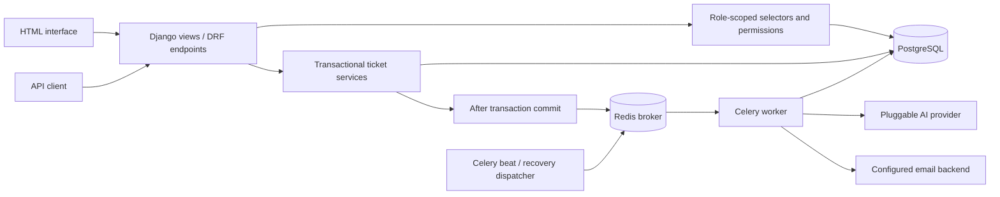

# Smart Support Desk — engineering guide

Start with the [portfolio overview](../README.md). This guide retains the detailed API, data model and operational notes.

A customer support platform built with Django and Django REST Framework. Customers open tickets and follow conversations; support employees manage scoped queues, collaborate through internal notes, and review optional AI-generated summaries and reply drafts.

**The application works without a cloud AI key.** The default cloud provider explicitly displays “AI not configured” when its credentials are missing and produces no invented analysis. AI drafts are never sent automatically.

Alternatively, the included `LocalModelProvider` runs real inference against a local llama.cpp server without a cloud key. English and Arabic interfaces are available, including a CSRF-protected language switch and RTL layout.

## Overview

This project demonstrates backend engineering through an end-to-end support workflow: relational modeling, authentication, object-level access control, transactional services, background jobs, a documented REST API, and a responsive server-rendered interface.

The default database is PostgreSQL. An explicit SQLite development mode lets reviewers run the project without Docker or a database server.

## Features

- Customer registration, session login/logout, profile editing, password change, and email-based password reset.
- JWT access and rotating refresh tokens, refresh-token blacklisting, and password-change revocation checks.
- Customer, support employee, and administrator roles with shared authorization rules across HTML and API views.
- Ticket creation, department routing, assignment, triage, controlled status transitions, and administrator deletion.
- Public replies and private internal notes; customers never receive internal notes or unapproved AI drafts.
- Private ticket attachments: PNG/JPEG/PDF, 5 MB per file, 10 files per ticket, authenticated downloads.
- In-app notifications, optional background email, ticket event history, and role-scoped analytics.
- Search, date ranges, filtering, pagination, and semantic priority ordering.
- Interactive Swagger documentation with locally served assets.
- Safe, idempotent development demo seeding with generated passwords and labeled synthetic records.
- English/Arabic UI, translated forms and system events, localized charts, and RTL navigation.

## Quick start: local demo

Requires Python 3.14. Run from the repository root.

```powershell
python -m venv .venv
.\.venv\Scripts\python -m pip install -r requirements.txt
.\.venv\Scripts\python scripts/bootstrap.py --sqlite --seed
.\.venv\Scripts\python manage.py runserver
```

On Linux/macOS, replace `.\.venv\Scripts\python` with `.venv/bin/python`.

Open [http://127.0.0.1:8000](http://127.0.0.1:8000). The bootstrap script generates an ignored `.env` with a unique secret, enables local SQLite, and runs tasks synchronously. It **preserves an existing `.env`**; `--sqlite` does not overwrite an existing configuration.

`seed_demo` prints a generated password for each newly created demo account. Accounts are `demo_customer`, `demo_customer_two`, `demo_employee`, and `demo_admin`, using `example.invalid` email addresses. Passwords are not hardcoded, stored in documentation, or reset on repeated seeding. If you lose a demo password, use Django’s `changepassword` management command locally. Demo seeding refuses to run with `DEBUG=False`.

The development setup performed for this checkout saved the first seed output in ignored `.local/demo-credentials.txt`. That file is local convenience data and must never be committed.

## Tech stack

| Area | Implementation |
| --- | --- |
| Language/runtime | Python 3.14 |
| Web/API | Django 6.1.2, Django REST Framework 3.18.3 |
| Database | PostgreSQL 18; explicit SQLite development option |
| Background work | Celery 5.6.3, Redis 8.10 |
| Authentication | Django sessions, Simple JWT 5.5.1 |
| API documentation | drf-spectacular, OpenAPI 3, Swagger sidecar assets |
| Frontend | Django templates, HTML5, custom CSS, vanilla JavaScript/canvas |
| AI | Configurable providers: OpenAI Responses and a real local llama.cpp model, using HTTPX |
| Deployment | Docker Compose, Gunicorn, WhiteNoise |
| Verification | Django test suite; GitHub Actions PostgreSQL/Redis integration workflow |

`requirements.txt` records exact resolved Python versions. `requirements.in` expresses compatible direct dependencies. Redis’s Python client is constrained by Celery/Kombu compatibility. Container images track stable minor/major release tags so security patch releases can be pulled; pin image digests for controlled production rollouts.

## Architecture



- `accounts`: custom user, role, department membership, web forms, account API, and administrator user management.
- `tickets`: ticket domain models, visibility selectors, permissions, validators, transactional services, HTML views, API, and notification tasks.
- `ai_service`: typed analysis result, cloud/local provider adapters, draft privacy checks, and analysis orchestration.
- `dashboard`: scoped aggregates, HTML dashboards, and dashboard API.
- `core`: landing/health views, shared context, management commands, and token cleanup task.
- `config`: environment settings, URLs, WSGI, Celery, and isolated test/CI settings.

Notifications and departments belong to the ticket domain; separate apps would add indirection without improving this project.

## Database

| Model | Purpose |
| --- | --- |
| `User` | Django user plus role and many-to-many department membership; case-insensitive unique email |
| `Department` | Active/archived support team |
| `Ticket` | Customer, assignee, department, lifecycle, triage, sentiment, AI results and processing lease |
| `TicketReply` | Public reply or staff-only internal note |
| `Attachment` | Private file, original name, uploader and parent ticket |
| `TicketEvent` | Staff-visible workflow event history |
| `Notification` | Per-user in-app update and durable email delivery state |

Tickets protect customer and department references. Optional assignees become null if deleted. Replies protect author references. Tickets use unique opaque public numbers; sequential API IDs are protected by authorization, rather than treated as secrets. Composite indexes cover customer chronology, status/priority, department assignment, notification reads and pending work.

Department `DELETE` through the API archives the team. Ticket `DELETE` is administrator-only and schedules attached file cleanup after commit. Account deletion is intentionally absent from the API: administrators can deactivate users while preserving history.

### Ticket lifecycle

`open → in_progress / waiting / resolved / closed`; `in_progress` and `waiting` can move between active states or complete. `resolved → in_progress / closed`; `closed → open` requires support access. Customers can close their own tickets. Closed tickets reject new replies and uploads.

`resolved_at` is cleared on reopening. Resolution metrics use tickets that currently retain a resolution timestamp, including closed tickets that were resolved first. They do not claim to measure SLA compliance or historical multi-cycle resolution duration.

## Authentication and role-based permissions

| Role | Read scope | Allowed workflow |
| --- | --- | --- |
| Customer | Own tickets | Create, reply publicly, upload, close |
| Employee | Assigned tickets, own submitted tickets, unassigned tickets in member departments | Reply, internal note, status, priority/category, claim available tickets |
| Employee with `tickets.assign_ticket` | Same read scope | Also transfer assignments/departments within visible tickets |
| Administrator | Entire workspace | All workflows, user/role/permission and department management |

All ticket lookups start from `visible_tickets(user)`. Guessing another ticket ID returns 404. Service methods recheck access under row locks before mutations. Assignees must be active employees in the ticket’s department. Role checks do not rely on user-submitted fields.

The Django admin manages users, groups, granular permissions and departments. Ticket workflow changes use the main workspace/API so audit events and notifications are preserved; ticket/reply/notification records are read-only in Django admin. Administrator roles have application-wide admin permissions. Superuser access remains supported.

The browser uses Django sessions with CSRF. API clients use `Authorization: Bearer <access-token>`. Access tokens last 15 minutes; refresh tokens last one day and rotate. API logout blacklists the provided refresh token. Previously issued access tokens remain valid until expiry after logout. Access and refresh validate password-hash revocation after API, browser, reset or admin password changes; API password changes also blacklist outstanding refreshes. Deleted/inactive users cannot refresh. Do not store tokens in committed files or browser local storage.

Browser login, admin login and password reset each have a fixed budget of 15 POST attempts per source address per hour window; registration has 5. Counters use atomic cache increments. Redis shares them across processes; LocMemCache is a single-process development fallback. Limits include successful attempts, and window boundaries can allow bursts. `REMOTE_ADDR` must reflect securely configured proxy handling. API auth uses DRF's separate scoped limit. These are application controls, not denial-of-service protection.

Password reset is available through `/accounts/password_reset/`, using Django’s signed, single-use token workflow. Configure SMTP before expecting external delivery; the development console backend prints reset emails locally.

## REST API

Interactive docs: `/api/docs/`. OpenAPI schema: `/api/schema/`. A generated snapshot is included as `schema.yaml`.

| Endpoint | Methods | Purpose |
| --- | --- | --- |
| `/api/auth/register/` | POST | Register a customer |
| `/api/auth/token/` | POST | Obtain JWT pair with username/password |
| `/api/auth/token/refresh/` | POST | Rotate refresh token |
| `/api/auth/logout/` | POST | Blacklist own refresh token |
| `/api/auth/me/` | GET, PUT, PATCH | Read profile; update first/last name |
| `/api/auth/password/change/` | POST | Validate old password, set new password |
| `/api/tickets/` | GET, POST | Scoped list / create |
| `/api/tickets/{id}/` | GET, PUT, PATCH, DELETE | Details, staff triage, admin deletion |
| `/api/tickets/{id}/reply/` | POST | Add a reply or staff internal note |
| `/api/tickets/{id}/status/` | POST | Apply a permitted status transition |
| `/api/tickets/{id}/assign/` | POST | Claim, transfer, or unassign |
| `/api/tickets/{id}/attachments/` | POST multipart | Upload private ticket attachment |
| `/attachments/{id}/download/` | GET | Authorized binary download; session or JWT |
| `/api/departments/`, `/api/departments/{id}/` | GET; admin POST/PUT/PATCH/DELETE | Department management |
| `/api/users/`, `/api/users/{id}/` | GET, PUT, PATCH | Admin user/role/department management |
| `/api/notifications/`, `/api/notifications/{id}/` | GET list, PUT/PATCH item | Read notifications / update `is_read` |
| `/api/dashboard/` | GET | Aggregates for the current user’s visible tickets |
| `/health/` | GET | Database availability without infrastructure details |

Ticket list examples:

```text
/api/tickets/?search=SSD-&status=open&priority=high
/api/tickets/?department=1&assigned_to=3&category=technical
/api/tickets/?created_after=2026-01-01&created_before=2026-12-31
/api/tickets/?ordering=-priority,created_at&page=2
```

Priority ordering uses numeric business rank, not alphabetical strings. Page size is 20 (HTML ticket list: 15). Customer responses omit AI fields, internal notes, and staff event history. Filter choices also respect ticket visibility.

Example JSON bodies:

```json
{"subject": "Unable to export a report", "description": "The export fails with an error.", "department": 1}
```

```json
{"message": "Could you share the time of the failed export?", "is_internal_note": false}
```

```json
{"status": "in_progress"}
```

```json
{"assigned_to": 3}
```

## AI features

When a ticket is committed, a background task asks the configured provider for category, priority, sentiment, a short summary and a draft reply. Both adapters request schema-constrained JSON and validate allowed choices and text lengths locally. Common requests for passwords, OTPs and payment secrets are rejected before saving a draft. This heuristic is an additional check, not a guarantee of safe or correct output. The cloud adapter requests `store: false`.

Set `AI_API_KEY` and `AI_MODEL` to use a model available to your account that supports Responses structured outputs. No model is silently selected, no key is shipped, and no external AI call is made when configuration is missing. You can change `AI_BASE_URL` for a trusted compatible endpoint, or set `AI_PROVIDER` to the Python import path of a class implementing `analyze(subject=..., description=...) -> Analysis`.

Only subject and description are sent. The adapter does not read or send attachments, account email, authentication passwords or internal notes. Customer-authored ticket text can itself contain private information: obtain the appropriate permission before enabling an external provider for real customers. Treat any provider’s response as untrusted, human-reviewed advice; prompt wording cannot guarantee resistance to all prompt injection.

Results appear only to support staff. “Use draft in reply” copies text into the composer, where it can be edited or ignored. It does not submit a form. Human triage changes take precedence over later AI classification. Missing configuration becomes `disabled`; provider failures become `failed`, while ticket creation and manual support remain available.

**Verification status:** real inference was executed with Qwen3-0.6B Q4_K_M through llama.cpp, including English and Arabic samples. A real background round trip through PostgreSQL, Redis and Celery saved generated analysis without creating a customer reply. The OpenAI cloud adapter remains contract-tested with mocks; no cloud key was supplied.

The small local model is a demonstration option. Testing exposed wrong categories, language failures and an unsafe credential request; prompts were refined, credential-request rejection was added, and Arabic-language validation now rejects non-Arabic text instead of presenting it as successful. Outputs can still be irrelevant or inaccurate. These checks are not a benchmark, and employee review remains mandatory. Use an appropriately evaluated stronger model for real support operations.

Adapter design follows [official OpenAI structured output documentation](https://developers.openai.com/api/docs/guides/structured-outputs?api-mode=responses).

### Free local AI

Run a [llama.cpp server](https://github.com/ggml-org/llama.cpp/tree/master/tools/server) with a GGUF model. The verified demo used [Unsloth’s Qwen3-0.6B Q4_K_M](https://huggingface.co/unsloth/Qwen3-0.6B-GGUF), approximately 397 MB, and an official llama.cpp Windows CPU binary. Model weights and executables are ignored local artifacts, not part of the repository.

```text
llama-server -m /absolute/path/Qwen3-0.6B-Q4_K_M.gguf --host 127.0.0.1 --port 8081 --ctx-size 8192 --parallel 1 --threads 2 --no-webui
```

Set the following in your private `.env`, then restart the web app and worker:

```dotenv
AI_PROVIDER=ai_service.providers.LocalModelProvider
AI_BASE_URL=http://127.0.0.1:8081/v1
AI_MODEL=Qwen3-0.6B-Q4_K_M
AI_API_KEY=
```

The local adapter accepts only loopback endpoints and bypasses environment proxies. It sends no ticket data to a cloud provider. It rejects incomplete generation and, for Arabic tickets, results without Arabic text. Its model server has no browser UI or tool execution enabled. Keep its listener on loopback. In Docker, loopback refers to the container: use the cloud adapter or a deliberately configured custom adapter when your model is outside that container.

### Language support

Use **العربية / English** in the header. The application ships a 363-message Arabic gettext catalog, translated forms/choices, system event rendering, localized chart labels and RTL navigation. Customer-authored text is preserved. API field names and enum codes stay stable.

Compiled catalogs are committed, so ordinary installation needs no translation tooling. To update/recompile a catalog:

```text
python -m pip install -r requirements-dev.txt
python scripts/compile_translations.py
```

## Celery and Redis

Actual background jobs:

- `tickets.tasks.analyze_ticket`: ticket AI analysis.
- `tickets.tasks.send_notification_email`: optional generic email updates.
- `tickets.tasks.dispatch_pending`: redispatch pending work and expired five-minute processing leases.
- `core.tasks.purge_expired_tokens`: daily expired JWT token cleanup.

Database states form a small durable outbox. Tasks are published after database commit. A broker publication failure leaves the row pending; beat retries every minute, and `python manage.py retry_pending` provides manual recovery. `--retry-failed` resets failed emails and failed/disabled analysis after correcting configuration.

Database leases avoid ordinary duplicate processing, and completed jobs return early. Email is **at least once**, not exactly once: a process crash after SMTP acceptance and before recording success can cause a duplicate on recovery. Failed provider/SMTP requests require the explicit retry command; they are not retried indefinitely.

Use a single beat scheduler. In local eager mode, tasks run in the request process, so enabling a real AI provider can block local requests. Use Redis and a Linux Celery worker for normal asynchronous operation. Celery does not officially support native Windows workers; use Docker/WSL, or eager mode for local review. See [Celery’s platform guidance](https://docs.celeryq.dev/en/stable/getting-started/introduction.html).

For this checkout’s development verification, PostgreSQL 18.6 and a checksum-verified community Windows Redis 8.10.3 build were run privately on loopback, with a Celery `solo` worker. That verifies this development path; it is not a claim of official Windows support or Linux container execution.

## PostgreSQL and running locally

For native PostgreSQL, install runtime requirements and run `python scripts/bootstrap.py --configure-only` to generate private configuration. Set `DB_*` and leave `USE_SQLITE=False`. Connect as your local PostgreSQL administrator with `psql -U postgres`, then create a development role and its database:

```sql
CREATE ROLE supportdesk LOGIN;
\password supportdesk
CREATE DATABASE supportdesk OWNER supportdesk;
```

At the password prompt, enter the generated `DB_PASSWORD` from your private `.env`. Match `DB_HOST` and `DB_PORT` to your server. For local tests, a development-only role also needs `ALTER ROLE supportdesk CREATEDB;`; production app roles should not have that privilege. The Django runner creates and destroys a separate test database.

Run these commands after the database exists:

```text
python manage.py migrate
python manage.py createsuperuser
python manage.py runserver
celery -A config worker --loglevel=INFO
celery -A config beat --loglevel=INFO
```

Set `CELERY_BROKER_URL` to your Redis instance. For a single-process development demo, use `CELERY_TASK_ALWAYS_EAGER=True`. Set `DJANGO_DEBUG=True` only for local development; this prefixed variable avoids collisions with unrelated host `DEBUG` variables.

## Docker

Requires Docker Engine/Desktop and Compose v2. Generate local `.env` credentials first:

```text
python scripts/bootstrap.py --configure-only
docker compose up --build -d --wait
docker compose exec web python manage.py createsuperuser
docker compose exec web python manage.py seed_demo
```

The compose environment overrides the local SQLite/eager flags, database host/port and broker/cache addresses, and uses PostgreSQL + Redis + Celery. `seed_demo` is optional and requires development debug mode. After switching between native and Docker databases, remember that accounts/data belong to separate databases. If your native `.env` uses `LocalModelProvider`, switch to `OpenAIProvider` for this Compose stack or provide an appropriate custom container-network provider; the native loopback model server is not inside the web container. With no cloud key, the cloud adapter stays explicitly disabled.

Open `http://127.0.0.1:8000`. Free native port 8000 before starting this stack. Services are `web`, `postgres`, `redis`, `celery`, `beat`, and a one-shot `migrate` service that runs migrations and static collection before the application starts. PostgreSQL and Redis are internal services without published host ports. The web port is bound to loopback; its healthcheck waits for HTTP/database readiness. Named volumes preserve PostgreSQL data, Redis AOF, private files and collected static assets. Containers run the app as an unprivileged user.

Configuration generation requires only Python's standard library; `--configure-only` does not connect to a database or import Django. Existing `.env` files are preserved. Compose is a local HTTP development stack. Its loopback HTTP healthcheck must be adapted along with host/HTTPS settings for a production reverse proxy; never disable production transport controls merely to pass a healthcheck.

```text
docker compose logs -f web celery beat
docker compose exec web python scripts/verify_worker.py
docker compose stop
```

`verify_worker.py` creates and removes only its own synthetic records in a PostgreSQL debug database and requires a real worker with eager mode disabled. Its default mode verifies explicit no-key behavior; `--expect-analysis` verifies a configured real model. Do not run it against production.

**Local verification limit:** Docker and WSL are not installed, so Compose has not run here. PostgreSQL/Redis/Celery, local model inference and local SMTP were tested natively. CI now includes Compose startup, the containerized worker round trip and a real HTTP workflow; review its result after uploading the repository.

## Environment variables

| Variable | Purpose |
| --- | --- |
| `SECRET_KEY` | Required unique Django signing secret; startup fails if empty |
| `DJANGO_DEBUG` | Debug switch; production must be `False` |
| `ALLOWED_HOSTS` | Comma-separated accepted hosts |
| `CSRF_TRUSTED_ORIGINS` | Comma-separated trusted origins, including scheme |
| `USE_SQLITE` | Explicit development-only alternative to default PostgreSQL |
| `DB_NAME`, `DB_USER`, `DB_PASSWORD`, `DB_HOST`, `DB_PORT` | PostgreSQL connection |
| `CELERY_BROKER_URL` | Redis broker URL |
| `CELERY_TASK_ALWAYS_EAGER` | Synchronous development mode |
| `CELERY_TASK_DEFAULT_QUEUE` | Optional queue name; default `celery`; integration checks use a unique queue |
| `CACHE_URL` | Optional Redis cache for shared rate limits; configured by Compose |
| `AI_PROVIDER`, `AI_BASE_URL`, `AI_API_KEY`, `AI_MODEL` | Provider adapter and credentials |
| `EMAIL_NOTIFICATIONS` | Enable optional ticket update emails |
| `EMAIL_BACKEND` | Console, SMTP or another Django backend |
| `EMAIL_HOST`, `EMAIL_PORT`, `EMAIL_HOST_USER`, `EMAIL_HOST_PASSWORD`, `EMAIL_USE_TLS`, `EMAIL_USE_SSL`, `EMAIL_TIMEOUT` | SMTP settings; TLS and SSL are mutually exclusive |
| `DEFAULT_FROM_EMAIL` | Sender address |
| `SECURE_SSL_REDIRECT`, `SESSION_COOKIE_SECURE`, `CSRF_COOKIE_SECURE` | Production transport/cookie settings |

Runtime system configuration is environment-managed, not editable through a public configuration API. SMTP does not require an AI key. Password reset uses the configured email backend independently of `EMAIL_NOTIFICATIONS`.

## Testing and verification

The observed PostgreSQL result is **83 passing tests**, including concurrent assignment, AI leases and browser claim eligibility/race regressions. Real HTTP workflows passed in English and Arabic, as did a real PostgreSQL/Redis/Celery/local-model/SMTP round trip. A further staff HTTP workflow verified real AI without automatic replies, staff claiming, private notes, explicit public submission, scoped REST responses, triage and lifecycle transitions. It did not execute JavaScript or capture browser screenshots. See [the verification record](VERIFICATION.md) for exact checks and environment limits.

```text
python manage.py check
python manage.py makemigrations --check --dry-run
python manage.py migrate
python manage.py test --settings=config.test_settings
python manage.py spectacular --file schema.yaml --validate --fail-on-warn
python manage.py collectstatic --noinput
python -m pip check
python -m ruff check .
python -m black --check .
python -m djlint templates --check
python -m djlint templates --lint --profile=django
python scripts/smoke_http.py
python scripts/smoke_http.py --language ar
```

The isolated local test settings force SQLite, fast test-only password hashing, in-memory storage/email/cache, and no AI credentials. They must never be used to serve the application. For a real PostgreSQL service, use `python manage.py test --settings=config.ci_settings`.

The HTTP smoke check requires a running local development server and creates/removes only its own synthetic records. It exercises real session login, CSRF, ticket creation with a PNG upload, reply, scoped API reads, authenticated download, closing, metrics and logout. It was run successfully in this checkout; it is not a visual browser review.

The tests cover registration/credential validation, JWT rotation/revocation, sessions and CSRF, role escalation attempts, object ID access, scoped lists/statistics/filter choices, assignment, status timestamps, replies/internal notes, notifications after access changes, private attachments and forged uploads, AI validation/fallback/leases, broker outages, email idempotence under ordinary retries, real template rendering, admin boundaries, and idempotent demo seeding.

GitHub Actions runs the suite against PostgreSQL, validates the schema, builds Docker, and executes a real Redis/Celery worker round trip. A configured workflow is not a claim that a remote run has passed.

To reproduce the full worker/email integration check against your PostgreSQL and Redis development services:

```text
python -m pip install -r requirements-dev.txt
python scripts/verify_worker_stack.py
python scripts/verify_worker_stack.py --with-ai
```

The helper runs a temporary worker on a unique queue and a local SMTP sink, then removes its own synthetic records and stops both temporary processes. The first command verifies no-key fallback; the second calls the configured real model. A cloud model incurs its provider’s usual usage cost. The helper sends no external email.

## Security and deployment

- Keep `.env`, databases, media, logs and `.local` out of Git. `.gitignore` and `.dockerignore` enforce these exclusions.
- Use `DJANGO_DEBUG=False`, a unique long secret, exact hosts and trusted origins, and HTTPS with secure cookies for production. Run `python manage.py check --deploy` using production environment values.
- Terminate HTTPS at a trusted reverse proxy. Forward HTTPS to the app or configure trusted proxy handling deliberately; the app does not blindly trust forwarded headers.
- Never expose `MEDIA_ROOT` as public `/media/`. Downloads enforce ticket scope, use `Content-Disposition: attachment`, `nosniff`, and private/no-store caching.
- File checks validate extension, size, image structure/pixel limits and PDF header. They are not malware scanning or PDF sanitization. Add quarantine/scanning before accepting untrusted production documents at scale.
- Application-level login and API rate limits are provided. Compose uses shared Redis cache; native development falls back to process-local cache when `CACHE_URL` is omitted. Add edge rate limits and request-size limits for public deployment. DRF throttling is not a denial-of-service defense.
- Business logs use event identifiers and database IDs, not passwords, API keys or ticket bodies. Gunicorn access logs record method/status/duration without sensitive URL tokens. Do not enable HTTP request-body logging in your proxy or AI adapter.
- Back up PostgreSQL and private media together, monitor failed tasks, run one beat scheduler, and define retention and restore policies before production use.

## Screenshots

Screenshots are not included: browser automation could not complete a visual review in this environment. Do not present invented images as working screens. The [capture plan](screenshots/README.md) specifies filenames, roles, viewports and review criteria.

After starting the app, capture these real screens with clearly labeled `[Demo]` data:

1. Employee overview: metrics, activity chart and priority queue.
2. Ticket conversation with a public reply and a staff-only internal note.
3. Customer view of the same ticket demonstrating that the note and AI draft are absent.
4. Analytics and filters.
5. Swagger with authenticated ticket endpoints.
6. Mobile ticket details.
7. AI assistance with genuinely generated local-model results, alongside the employee review controls.
8. The Arabic interface and RTL navigation.

## Project structure

```text
accounts/                 Users, authentication, forms, serializers, admin
ai_service/               Provider contract, Responses adapter, orchestration
config/                   Settings, URLs, Celery and WSGI
core/                     Shared views, management commands, token cleanup
dashboard/                Scoped metrics, serializers and views
tickets/                  Domain models, migrations, services, permissions, API
templates/                Public, account, dashboard and ticket pages
static/                   CSS, JavaScript, icons and favicon
locale/ar/                Arabic gettext source and compiled catalog
tests/                    Domain, API, security, AI/task and template tests
scripts/                  Bootstrap, dependency lock, container init, worker check
docs/                     Arabic delivery report and implementation notes
.github/workflows/ci.yml  PostgreSQL/Redis CI and Docker build
compose.yaml              Full local service stack
schema.yaml               Generated OpenAPI snapshot
```

## Future improvements and explicit limits

- Attachments belong to tickets, rather than individual replies. Malware scanning and external private object storage are future work.
- Docker/Compose execution, cloud AI, external SMTP delivery and browser/mobile visual QA still require the corresponding environment. Local model inference, native PostgreSQL/Redis/Celery and local SMTP protocol delivery have been verified.
- Add SLA policies, account email verification, MFA, a knowledge base, WebSockets, and provider evaluation datasets only when required.
- Add a privacy/retention policy and operational backups before real customer use.

## GitHub presentation

Suggested repository description:

> Django support desk with a scoped REST API, ticket workflows, private notes, optional human-reviewed AI drafts, PostgreSQL, Celery, Redis, Docker and automated tests.

Suggested topics: `python`, `django`, `django-rest-framework`, `postgresql`, `redis`, `celery`, `docker`, `rest-api`, `openapi`, `backend`, `customer-support`, `ai-integration`, `web-development`.

## Author

Maintainer: **Atallah Alrashoud**, Python & Django Developer, Saudi Arabia. GitHub: [tayma-ops](https://github.com/tayma-ops). The [Developer section](../README.md#developer) reserves the LinkedIn link for the owner to complete. Project code is [MIT licensed](../LICENSE); third-party libraries, tools and model weights retain their own licenses. Model weights and native tools are not redistributed in this repository.
